# AquaMuestra · Registro de muestras de choritos en terreno

**Versión 1.0.0** · App Android (Kotlin + Jetpack Compose) con backend Spring Boot y MySQL.

AquaMuestra permite a los equipos de ALDEMAR SpA registrar en terreno los muestreos de choritos (centro, tren, línea, tramo y conteo), con foto de respaldo y conteo asistido sobre la imagen. La app funciona sin señal y sincroniza sola cuando vuelve la conexión. El supervisor revisa cada muestra y el analista ve indicadores y exporta reportes en PDF.

---

## Tabla de contenidos

1. [Problemática y solución](#problemática-y-solución)
2. [Integrantes](#integrantes)
3. [Stack tecnológico](#stack-tecnológico)
4. [Arquitectura](#arquitectura)
5. [Roles y permisos](#roles-y-permisos)
6. [Funcionalidades por pantalla](#funcionalidades-por-pantalla)
7. [Backend](#backend)
8. [API externa: Open-Meteo Marine](#api-externa-open-meteo-marine)
9. [Modo offline y sincronización](#modo-offline-y-sincronización)
10. [Instalación](#instalación)
11. [Pruebas](#pruebas)
12. [Capturas](#capturas)
13. [Seguridad](#seguridad)
14. [Planificación](#planificación)

---

## Problemática y solución

**Problemática de ALDEMAR SpA**

| Problema | Qué pasa hoy |
|---|---|
| **Conteo manual** | Los choritos de cada tramo de cuerda se cuentan a mano y se anotan en papel o planillas sueltas. Es lento y los errores no se pueden revisar después. |
| **Información dispersa** | Cada operario guarda sus datos a su manera (cuadernos, fotos en el teléfono, planillas). No hay un lugar único ni un formato común. |
| **Sin reportes** | No hay indicadores por centro o línea ni reportes listos para la jefatura. Comparar muestreos en el tiempo exige rearmar los datos a mano. |
| **Mala señal** | Los centros de cultivo están en el mar, con conectividad intermitente. |

**Solución: AquaMuestra**

- **Registro estructurado** con listas cerradas de centro, tren y línea, validaciones y un ID único (UUID) por muestra.
- **Conteo asistido**: se toma una foto y se toca cada chorito para marcarlo. El total se calcula solo y se puede corregir con un ajuste manual.
- **Funciona sin señal**: todo se guarda primero en el teléfono (Room) y se sube cuando hay conexión (WorkManager).
- **Flujo de revisión**: el operario envía, y el supervisor **valida** u **observa** con un comentario que el operario ve al corregir.
- **Indicadores y reportes**: un dashboard con gráficos por centro y por línea, más la exportación en PDF de las muestras validadas.
- **Contexto ambiental**: condiciones marinas del centro (ola, temperatura del mar, corriente) obtenidas de Open-Meteo.

---

## Integrantes

| Integrante | Rol en el proyecto |
|---|---|
| `<Nombre Apellido>` | `<rol en el proyecto>` |
| `<Nombre Apellido>` | `<rol en el proyecto>` |
| `<Nombre Apellido>` | `<rol en el proyecto>` |

---

## Stack tecnológico

| Capa | Tecnologías |
|---|---|
| **App (lenguaje y UI)** | Kotlin · Jetpack Compose · Material 3 |
| **Arquitectura** | MVVM (ViewModel + StateFlow) · patrón Repository |
| **Datos locales** | Room (muestras) · DataStore (sesión, preferencias y caché marina) |
| **Segundo plano** | WorkManager (sincronización) |
| **Red** | Retrofit + OkHttp (backend propio y Open-Meteo) |
| **Cámara e imágenes** | CameraX · Coil · Telephoto (zoom con pellizco) |
| **Gráficos y reportes** | Vico (gráficos) · `PdfDocument` de Android (reporte PDF) |
| **Backend** | Spring Boot · Spring Security (HTTP Basic + BCrypt) · Spring Data JPA |
| **Base de datos** | MySQL 8 en Docker |
| **Documentación de la API** | Springdoc OpenAPI / Swagger UI |
| **API externa** | Open-Meteo Marine API |
| **Pruebas** | JUnit · MockK · kotlinx-coroutines-test · Kover · Compose UI Test |

---

## Arquitectura

### App: capas MVVM

La UI solo muestra el estado y avisa de las acciones del usuario. El ViewModel decide qué hacer. El Repository es la única puerta a los datos, sea Room, la API o WorkManager.

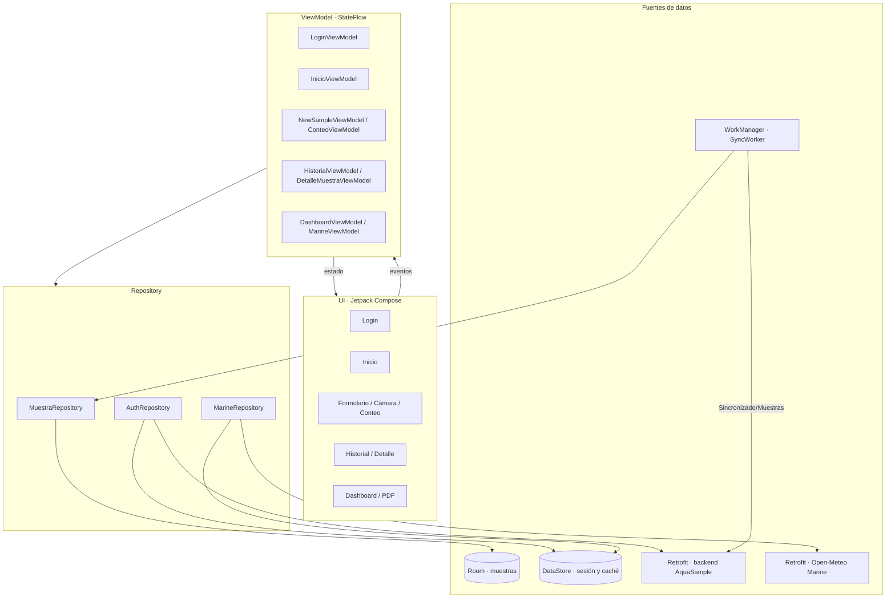

### Integración entre sistemas

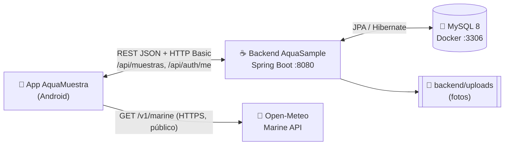

### Flujo de estados de una muestra

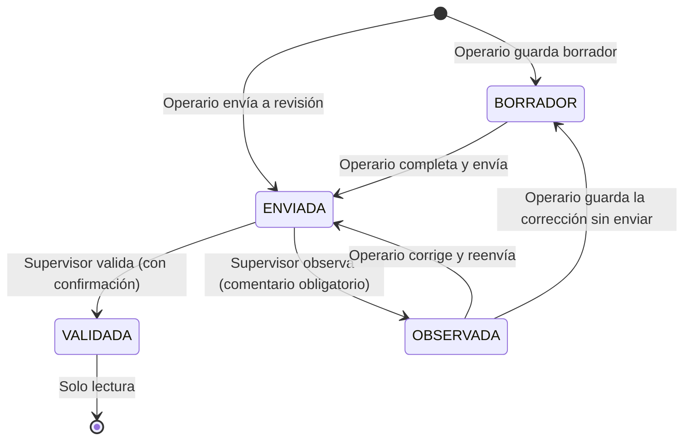

- Solo el **operario dueño** de la muestra (operador = usuario de la sesión) puede editarla o corregirla.
- Una muestra **VALIDADA** queda en solo lectura. Si un PUT intenta modificarla, el backend responde **409**.
- El backend también impide que un operario deje una muestra en OBSERVADA o VALIDADA: responde **403**.

### Sincronización offline

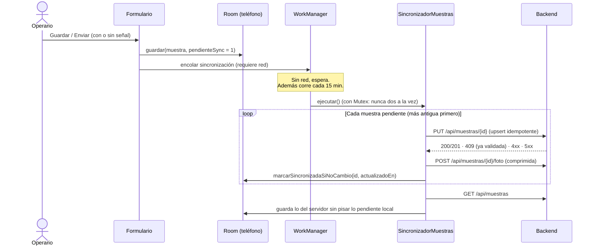

---

## Roles y permisos

| Acción | OPERARIO | SUPERVISOR | ANALISTA |
|---|:---:|:---:|:---:|
| Iniciar sesión y ver Inicio | ✅ | ✅ | ✅ |
| Crear muestras (formulario, cámara, conteo) | ✅ | ❌ (en la app) | ❌ |
| Editar o corregir **sus propias** muestras (BORRADOR u OBSERVADA) | ✅ | ❌ | ❌ |
| Ver historial y detalle | ✅ | ✅ | ✅ |
| Validar u observar muestras ENVIADAS | ❌ | ✅ | ❌ |
| Dashboard con indicadores | ❌ | ✅ | ✅ |
| Exportar reporte PDF | ❌ | ✅ | ✅ |

**En el backend**, Spring Security revisa los permisos en cada petición, de forma independiente de la app:

| Endpoint | OPERARIO | SUPERVISOR | ANALISTA |
|---|:---:|:---:|:---:|
| `GET /api/auth/me`, `GET /api/muestras/**` | ✅ | ✅ | ✅ |
| `POST` / `PUT /api/muestras/**` | ✅ (solo BORRADOR o ENVIADA) | ✅ | ❌ 403 |
| `PATCH /api/muestras/{id}/estado` | ❌ 403 | ✅ | ❌ 403 |
| `DELETE /api/muestras/{id}` | ❌ 403 | ✅ | ❌ 403 |
| `GET /api/reportes/resumen` | ❌ 403 | ✅ | ✅ |

Los usuarios de demostración son `op01` (Operario Demo), `su01` (Supervisor Demo) y `an01` (Analista Demo). Sus contraseñas están solo en `backend/.env`, que no se sube a git.

---

## Funcionalidades por pantalla

| Pantalla | Qué hace |
|---|---|
| **Login** | Ingreso con usuario y contraseña validados contra el backend (`/api/auth/me`). La sesión se guarda en DataStore, así que después del primer ingreso la app abre sin señal. |
| **Inicio** | Saludo con nombre y chip de rol, aviso de sincronización (pendientes / sin conexión) y accesos según el rol: operario → *Nueva muestra* y *Mis muestras*; supervisor → *Por revisar (N)* y *Dashboard*; analista → *Dashboard*, *Historial* y *Exportar reporte*. Muestra las últimas 3 muestras y las condiciones marinas. El menú superior tiene modo oscuro, sincronizar ahora y cerrar sesión. |
| **Cerrar sesión** | Si quedan muestras sin subir, pregunta con *Sincronizar y salir* (espera el resultado y avisa si no hay conexión), *Salir igual* o *Cancelar*. |
| **Nueva muestra / Corregir** | Centro, concesión, tren y línea (listas), fecha y hora, **operador fijo con el usuario de la sesión**, tramo en cm, foto, conteo y observaciones. Valida los campos obligatorios y marca cada error bajo su campo. *Guardar borrador* no exige foto; *Enviar a revisión* sí. En modo corrección muestra arriba el comentario del supervisor y quién lo escribió. |
| **Cámara** | Cámara propia con CameraX: guía de encuadre, flash, vista previa y *Repetir* / *Usar foto*. |
| **Conteo** | Se toca cada chorito sobre la foto para marcarlo (numerado) y se toca una marca para quitarla. Tiene *Deshacer*, *Limpiar* y un ajuste ±. El zoom es con pellizco; el doble toque está desactivado para que los toques rápidos se cuenten como marcas. |
| **Historial de muestras** | Lista con filtros por estado, centro, tren y línea, un contador "N de M" y *Limpiar filtros*. Desde aquí también se exporta el PDF. |
| **Detalle** | Foto con zoom y marcas, conteo (marcados + ajuste), densidad en ind/m, datos del muestreo, estado de revisión y la **evolución de la línea**, que compara la densidad con los muestreos anteriores. Según el rol, ofrece *Corregir*, *Validar* (pide confirmación) u *Observar* (comentario obligatorio). |
| **Dashboard** | Filtros por período (7 días, 30 días, todo) y centro. Muestra KPIs (muestras, individuos, densidad promedio y por revisar), barras por centro, el desglose por estado y una línea de tiempo de la densidad de una línea (gráficos con Vico). |
| **Reporte PDF** | PDF A4 horizontal con las muestras **validadas** según los filtros: encabezado con autor y fecha, tabla paginada, totales y el pie "Datos sintéticos para uso académico". Se guarda donde elija el usuario y se abre desde el aviso. |

---

## Backend

El backend está en [`backend/`](backend/). La guía completa está en **[backend/README-backend.md](backend/README-backend.md)**.

### Levantar MySQL y el backend

```powershell
cd backend
Copy-Item .env.example .env   # luego edita .env y cambia TODAS las claves
docker compose up -d          # crea el contenedor aquasample-mysql
docker compose ps             # debe decir "healthy"
```

Desde la carpeta `backend`, carga las variables de `.env` y levanta el backend:

```powershell
Get-Content .env | Where-Object { $_ -match '^[A-Z_]+=' } | ForEach-Object { $k, $v = $_ -split '=', 2; Set-Item "env:$k" $v }
.\mvnw.cmd spring-boot:run
```

Al arrancar por primera vez, el backend crea los usuarios demo (con contraseña en BCrypt) y 6 muestras de ejemplo con UUID aleatorios.

### Swagger

- Swagger UI: **<http://localhost:8080/swagger-ui.html>** (público). Con el botón *Authorize* se ingresa usuario y contraseña.
- OpenAPI JSON: <http://localhost:8080/v3/api-docs>

### Endpoints

| Método | Ruta | Rol requerido | Descripción |
|---|---|---|---|
| `GET` | `/api/auth/me` | Cualquier usuario autenticado | Devuelve username, nombre y rol. La app lo usa para validar el login. |
| `GET` | `/api/muestras` | Cualquiera | Lista las muestras, de la más reciente a la más antigua. Filtros opcionales: `centro`, `tren`, `linea`, `estado`, `desde`, `hasta` (yyyy-MM-dd). |
| `GET` | `/api/muestras/{id}` | Cualquiera | Obtiene una muestra. Responde 404 si no existe. |
| `POST` | `/api/muestras` | OPERARIO, SUPERVISOR | Crea una muestra con el UUID que envía la app. Responde 409 si el id ya existe. |
| `PUT` | `/api/muestras/{id}` | OPERARIO, SUPERVISOR | **Upsert idempotente**: crea la muestra (201) o la actualiza (200). Es el endpoint de la sincronización. Un operario solo puede dejarla en BORRADOR o ENVIADA (si no, 403). Si ya está VALIDADA, responde 409. |
| `PATCH` | `/api/muestras/{id}/estado` | SUPERVISOR | Revisión: VALIDADA u OBSERVADA. OBSERVADA exige comentario (si falta, 400). Guarda `revisadoPor`. |
| `POST` | `/api/muestras/{id}/foto` | OPERARIO, SUPERVISOR | Sube la foto (multipart, campo `archivo`; JPEG o PNG, máximo 5 MB). |
| `GET` | `/api/muestras/{id}/foto` | Cualquiera | Descarga la foto. |
| `DELETE` | `/api/muestras/{id}` | SUPERVISOR | Elimina una muestra. |
| `GET` | `/api/reportes/resumen` | SUPERVISOR, ANALISTA | Totales por estado y por centro, y densidad promedio. |

Los errores responden con un JSON uniforme (`status`, `mensaje`, `ruta` y, cuando aplica, `errores` por campo): 400, 401, 403, 404, 409 y 413.

---

## API externa: Open-Meteo Marine

- **Servicio**: [Open-Meteo Marine Weather API](https://open-meteo.com/en/docs/marine-weather-api). Es pública, gratuita y no requiere clave. URL base: `https://marine-api.open-meteo.com/` (configurable con `MARINE_BASE_URL`).
- **Consulta**: `GET /v1/marine?latitude=…&longitude=…&current=…&timezone=auto`, usando las coordenadas aproximadas de cada centro de cultivo.
- **Variables usadas** (`current`):

| Variable | En la app |
|---|---|
| `wave_height` | Altura de ola (m) |
| `wave_period` | Período de la ola (s) |
| `wave_direction` | Dirección desde la que vienen las olas |
| `sea_surface_temperature` | Temperatura del mar (°C) |
| `ocean_current_velocity` | Velocidad de la corriente (km/h) |
| `ocean_current_direction` | Dirección hacia la que va la corriente |

- **Carácter referencial**: es un **dato estimado por un modelo**, no una medición en el centro. La tarjeta lo dice explícitamente ("Dato estimado de Open-Meteo, no es una medición del centro"), junto con la hora del dato, las coordenadas aproximadas y la fuente.
- **Manejo de errores**:
  - El último dato bueno de cada centro se guarda en DataStore (`CacheMarino`).
  - **Sin conexión**: muestra el último dato guardado con su hora ("Sin conexión · Último dato disponible: …") o avisa que aún no hay datos.
  - **Error HTTP, timeout o respuesta sin datos**: muestra el error con el botón *Reintentar*, y el dato en caché si existe.
  - Nunca bloquea el resto de la pantalla.

---

## Modo offline y sincronización

**Cómo funciona**

1. **Primero el teléfono**: toda muestra se guarda en Room con `pendienteSync = 1`, haya señal o no.
2. **WorkManager** encola una sincronización inmediata con restricción de red. Si no hay red, espera, y reintenta con *backoff* lineal ante fallos. Además hay una sincronización periódica cada 15 minutos.
3. **Subir**: cada pendiente se envía con `PUT /api/muestras/{id}` y luego su foto, comprimida en un temporal que siempre se borra.
4. **Bajar**: se traen las muestras del servidor y se guardan en Room, **sin pisar las que siguen pendientes** en el teléfono (lo local pendiente gana).
5. La UI muestra el estado: banner "Sin conexión · N pendientes", ícono de nube en cada tarjeta y la opción "Sincronizar ahora" en el menú.

**Cómo se evita la duplicación**

| Mecanismo | Qué evita |
|---|---|
| **UUID generado en el teléfono** al crear la muestra | Que el servidor invente otro id: la misma muestra tiene el mismo id en todas partes. |
| **`PUT /{id}` idempotente (upsert)** | Que reenviar la misma muestra (por reintento o corte de red) cree un duplicado: solo la actualiza. |
| **Mutex** en `SincronizadorMuestras` y trabajo único en WorkManager (`KEEP` / `APPEND_OR_REPLACE`) | Que dos sincronizaciones suban la misma muestra al mismo tiempo. |
| **`marcarSincronizadaSiNoCambio(id, actualizadoEn)`** | Perder una edición hecha mientras se subía: si la muestra cambió, sigue pendiente y se vuelve a subir. |
| **409 si ya está VALIDADA** | Pisar una revisión: en ese caso gana el servidor y la app trae su versión. |

---

## Instalación

### Requisitos

- Android Studio (reciente, con su JDK incluido) y el Android SDK 37.
- Un teléfono o emulador con **Android 7.0 (API 24)** o superior.
- Docker Desktop (para MySQL) y **JDK 25** para el backend, que usa el wrapper `mvnw`, así que no hace falta instalar Maven.

### `local.properties`

Copia [`local.properties.example`](local.properties.example) como `local.properties` en la raíz y completa los valores. Ese archivo **no se sube a git**.

```properties
sdk.dir=C:/Users/TU_USUARIO/AppData/Local/Android/Sdk
API_BASE_URL=http://10.0.2.2:8080/          # emulador: 10.0.2.2 = localhost del PC
MARINE_BASE_URL=https://marine-api.open-meteo.com/
KEYSTORE_PATH=C:/ruta/a/tu/keystore.jks       # solo para la APK release
KEYSTORE_PASSWORD=                             # la completa cada uno, nunca en git
KEY_ALIAS=tu_alias
KEY_PASSWORD=
```

### Compilar e instalar la versión debug

```powershell
.\gradlew.bat :app:assembleDebug
```

```powershell
adb install -r app\build\outputs\apk\debug\aquamuestra-v1.0.0-debug.apk
```

### APK release firmada

1. Crea un keystore propio, fuera del repositorio (por ejemplo, con *Build → Generate Signed App Bundle/APK* de Android Studio o con `keytool`).
2. Completa `KEYSTORE_PATH`, `KEYSTORE_PASSWORD`, `KEY_ALIAS` y `KEY_PASSWORD` en `local.properties`, o defínelos como variables de entorno con el mismo nombre. **Las contraseñas no se escriben en ningún archivo versionado.**
3. Compila:

```powershell
.\gradlew.bat :app:assembleRelease
```

El resultado es `app/build/outputs/apk/release/aquamuestra-v1.0.0-release.apk` (`versionCode 1`, `versionName 1.0.0`). Si falta un dato de firma, la tarea `verificarFirmaRelease` detiene el build y dice cuál falta.

### Instalar la APK en el teléfono

1. En el teléfono, activa *Opciones de desarrollador → Depuración USB* y conéctalo al PC.
2. Instala:

```powershell
adb install -r app\build\outputs\apk\release\aquamuestra-v1.0.0-release.apk
```

Si antes había una versión debug, Android rechaza la release por tener otra firma. En ese caso desinstala primero la debug (`adb uninstall com.aldemar.aquamuestra`), lo que borra los datos locales de la app.

### Configurar la IP del backend (teléfono físico)

El teléfono y el PC deben estar en la **misma red**: el mismo Wi-Fi, o el PC conectado al **hotspot del teléfono**.

1. En el PC, busca la IPv4 de la red activa con `ipconfig`.
2. Pon esa IP en `local.properties`: `API_BASE_URL=http://<IP-del-PC>:8080/`.
3. Agrega la misma IP como `<domain>` en `app/src/main/res/xml/network_security_config.xml` (HTTP en claro solo para esa IP local).
4. Permite Java en el firewall de Windows para redes **privadas** (puerto 8080).
5. Recompila e instala la APK. En Android 17 o superior, acepta el permiso de **dispositivos cercanos / red local** la primera vez.

---

## Pruebas

### Cómo correrlas

Tests unitarios de la app (JVM, sin emulador):

```powershell
.\gradlew.bat :app:testDebugUnitTest
```

Cobertura con Kover (falla si las líneas cubiertas bajan del 90 %), más el reporte HTML en `app/build/reports/kover/htmlDebug/index.html`:

```powershell
.\gradlew.bat :app:koverVerifyDebug :app:koverHtmlReportDebug
```

Tests de UI con Compose y tests instrumentados (requieren un emulador encendido):

```powershell
.\gradlew.bat :app:connectedDebugAndroidTest
```

Tests del backend (usan H2 en memoria, no necesitan MySQL):

```powershell
cd backend; .\mvnw.cmd test
```

### Resultados actuales (v1.0.0)

| Suite | Tests | Resultado |
|---|---:|---|
| Unitarios de la app (`testDebugUnitTest`) | **172** | ✅ 0 fallos |
| UI e instrumentados (`connectedDebugAndroidTest`): login, formulario y PDF | **6** | ✅ |
| Backend (`mvnw test`): contexto e integración de seguridad | **8** | ✅ |

| Cobertura Kover (app, debug) | Valor |
|---|---:|
| Líneas | **99,74 %** (754 / 756) |
| Ramas | **92,36 %** |
| Mínimo exigido (`koverVerifyDebug`) | 90 % de líneas |

Kover mide la lógica: ViewModels, repositorios, red, sincronización y reglas. Las pantallas Compose, la cámara y el generador del PDF se prueban con tests de UI e instrumentados, y en el emulador.

### Test destacado para la demo

**`InicioViewModelTest` → "dadas pendientes cuando elige sincronizar y salir y todo sube entonces sale"**
(`app/src/test/java/com/aldemar/aquamuestra/viewmodel/InicioViewModelTest.kt`)

Muestra en pocas líneas el modo offline completo: hay 2 muestras sin subir, el usuario elige *Sincronizar y salir*, se sincroniza **una sola vez** y, como ya no quedan pendientes, la sesión se cierra. Los tests vecinos cubren qué pasa sin internet (avisa y no sale), cuando el servidor no acepta todo (avisa cuántas quedan) y cuando se toca dos veces (no sincroniza dos veces).

Ejecutarlo solo:

```powershell
.\gradlew.bat :app:testDebugUnitTest --tests "com.aldemar.aquamuestra.viewmodel.InicioViewModelTest"
```

---

## Capturas

Las capturas se tomaron en el emulador (Pixel 4a, Android 17) con la app v1.0.0 y el backend local. Están en [`docs/capturas/`](docs/capturas/).

| | | |
|:---:|:---:|:---:|
| 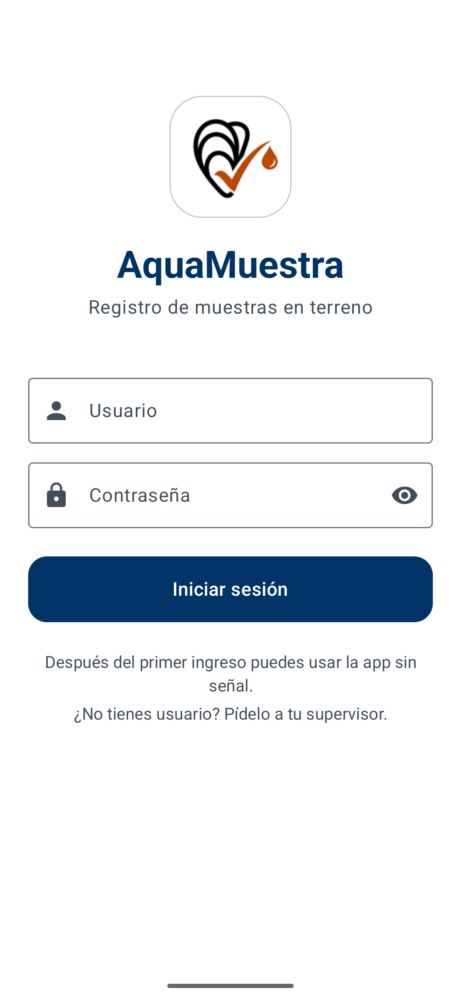<br/>**Login** | 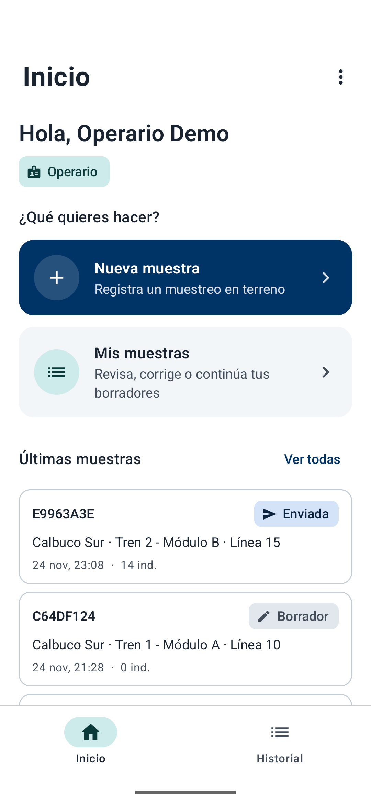<br/>**Inicio · Operario** | 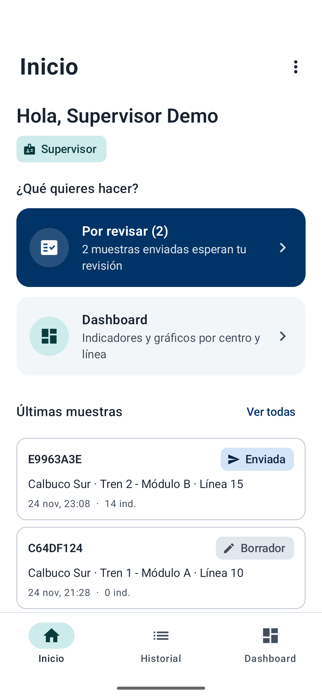<br/>**Inicio · Supervisor** |
| 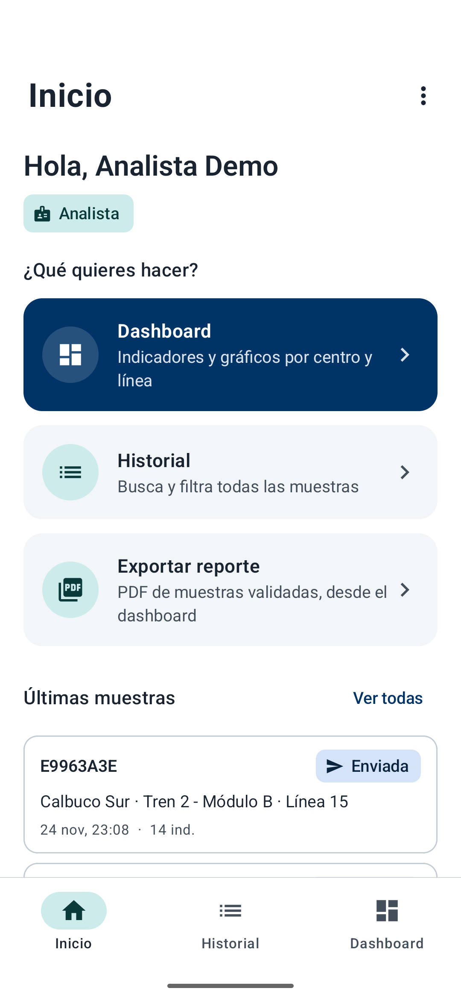<br/>**Inicio · Analista** | 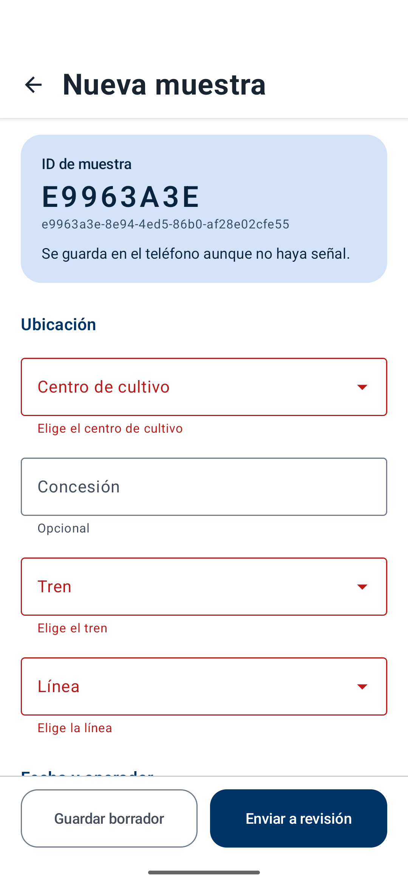<br/>**Formulario con errores** | 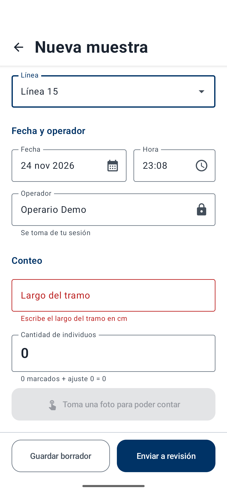<br/>**Operador fijo de la sesión** |
| 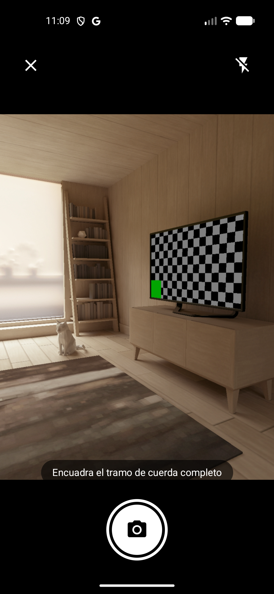<br/>**Cámara (CameraX)** | 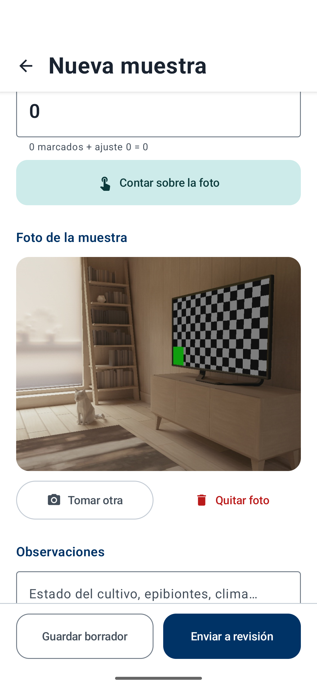<br/>**Formulario con foto** | 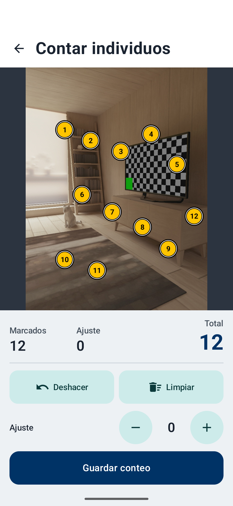<br/>**Conteo con marcas** |
| 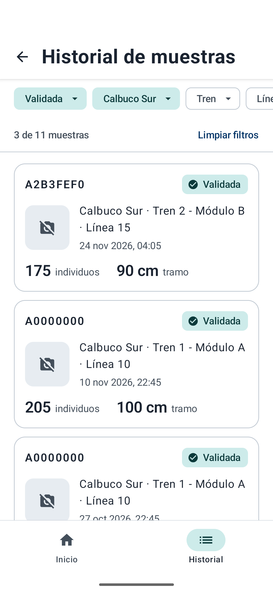<br/>**Historial con filtros** | 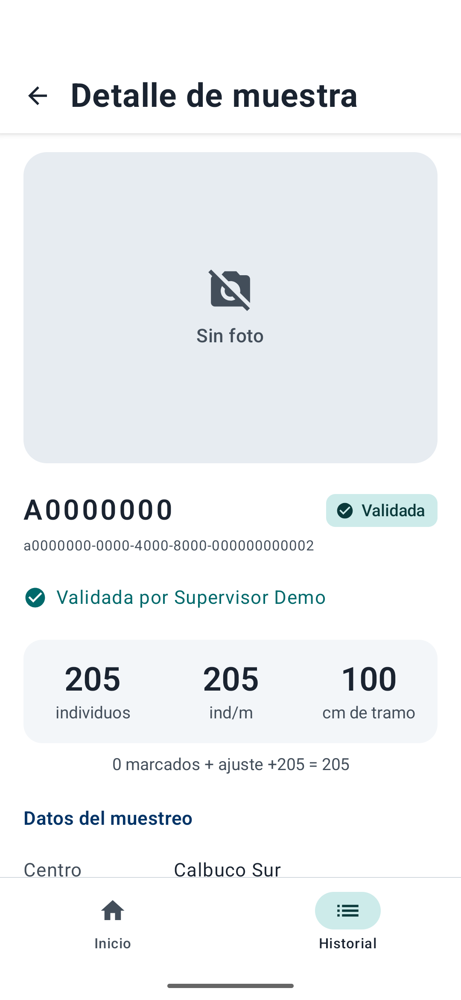<br/>**Detalle de muestra** | 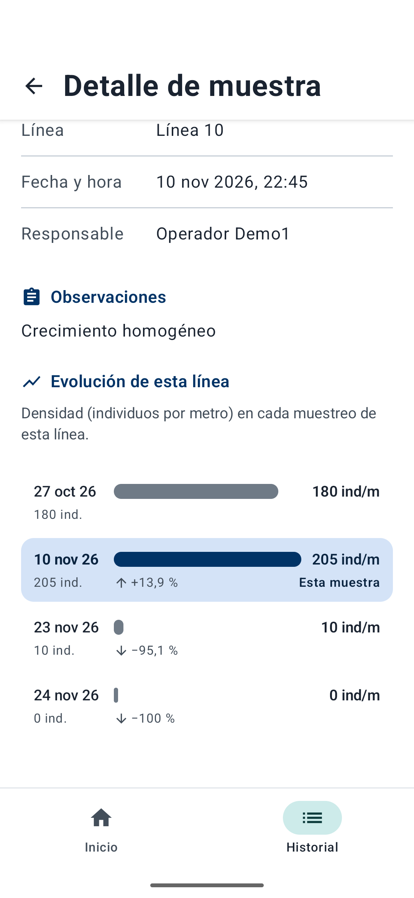<br/>**Detalle · evolución de la línea** |
| 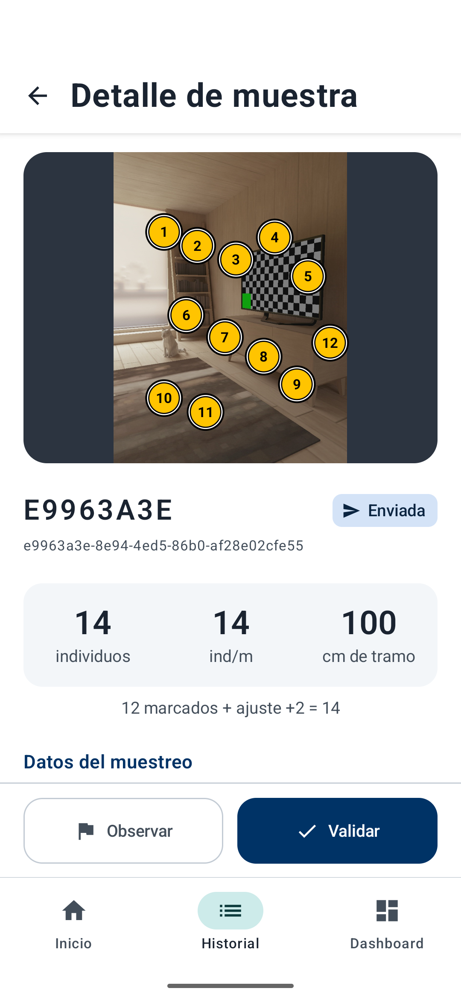<br/>**Revisión (Observar / Validar)** | 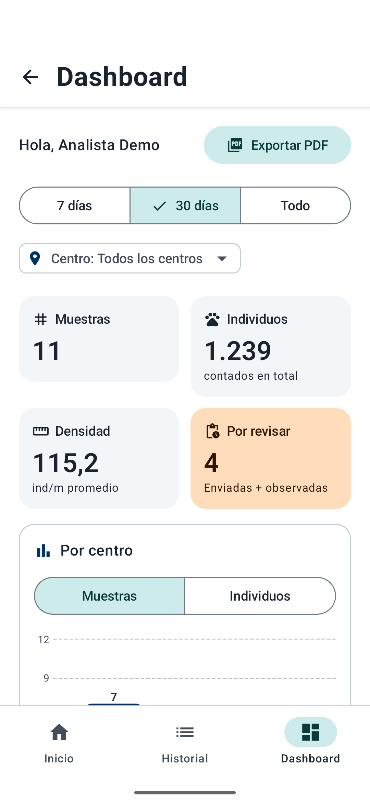<br/>**Dashboard · KPIs** | 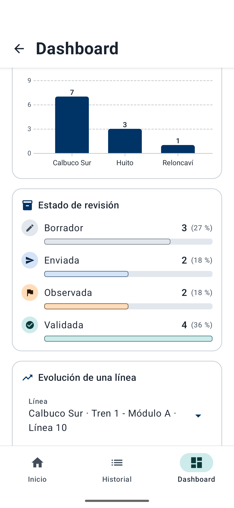<br/>**Dashboard · gráficos** |
| 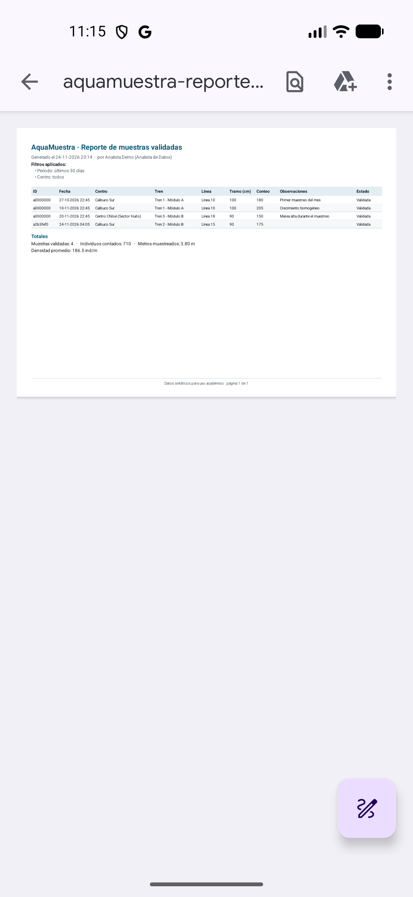<br/>**Reporte PDF** | 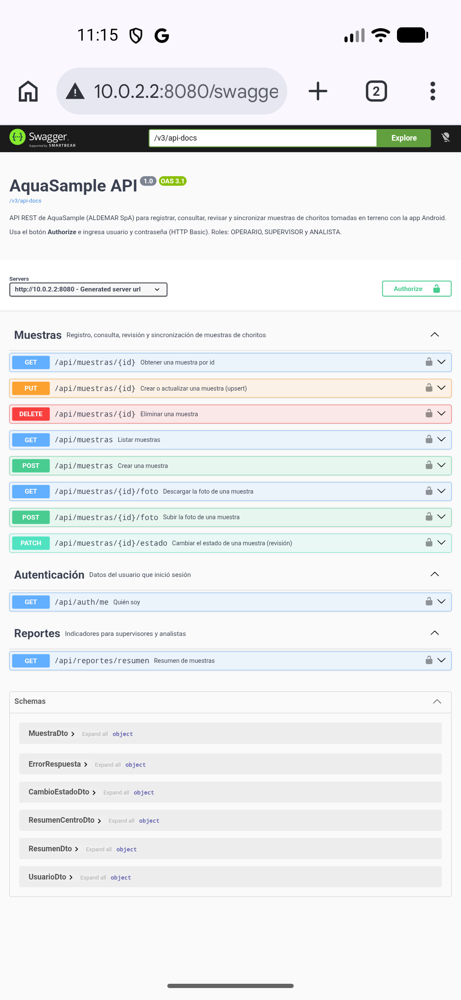<br/>**Swagger UI del backend** | |

---

## Seguridad

**Qué NO se sube al repositorio** (cubierto por `.gitignore`):

| Archivo | Contenido |
|---|---|
| `*.jks`, `*.keystore`, `keystore.properties` | Keystore y datos de firma de la APK release |
| `local.properties` | Ruta del SDK, URL del backend y contraseñas del keystore |
| `backend/.env` | Usuario y contraseñas de MySQL y contraseñas de los usuarios demo |
| `backend/uploads/` | Fotos subidas al backend |
| `build/`, `backend/target/`, `*.apk`, `*.aab` | Compilados y APKs |

Para cada archivo con datos privados hay una plantilla sin valores reales: [`local.properties.example`](local.properties.example) y `backend/.env.example`.

**Otras medidas**

- Contraseñas guardadas solo como hash **BCrypt** en la base de datos; las de la demo vienen de variables de entorno.
- Permisos por rol revisados **en el backend** (Spring Security), no solo en la app.
- HTTP en claro permitido solo para las IP locales de desarrollo (`network_security_config.xml`). Open-Meteo se consulta por HTTPS.
- **Datos sintéticos**: todas las muestras, usuarios y nombres son ficticios, creados para uso académico. El reporte PDF lo indica en el pie de cada página.

---

## Planificación

Tablero del proyecto: `<enlace Trello>`

---

**AquaMuestra v1.0.0** · Proyecto académico para ALDEMAR SpA · Datos sintéticos.
